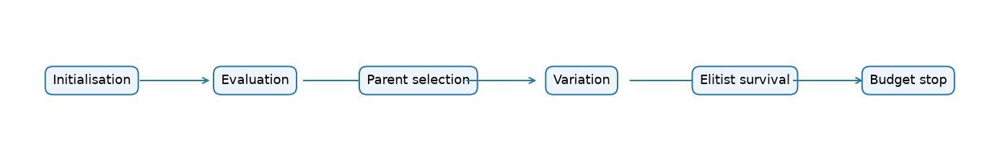
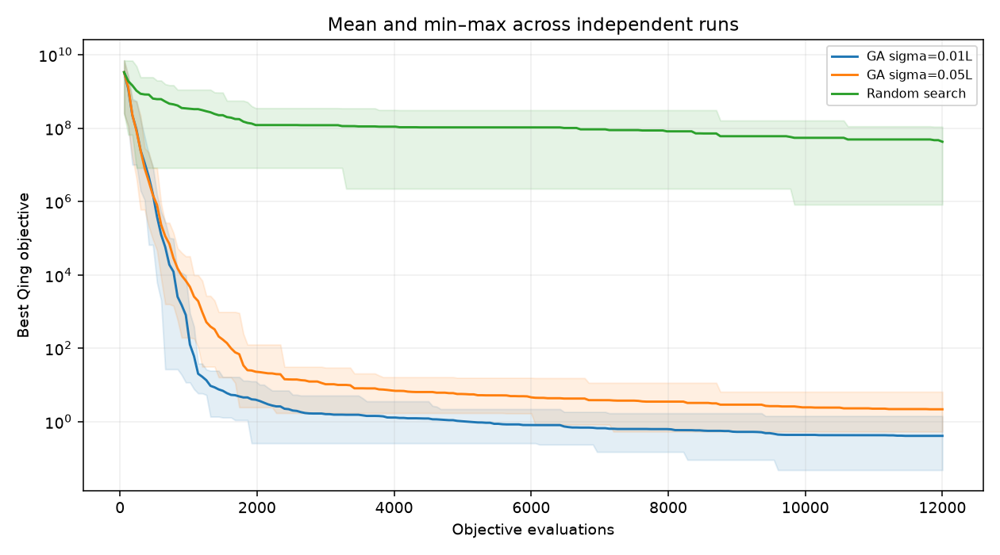

# Лабораторная работа 1 — многомерная оптимизация

## Постановка и представление

Минимизируется f(x)=Σᵢ₌₁⁵(xᵢ²−i)² на [-500,500]⁵. Размерность d=5+(12 mod 6)=5.
Генотип и фенотип — вещественный вектор из пяти координат; декодирование тождественное.
Точный глобальный минимум равен 0: xᵢ=±√i, всего 32 глобальных минимума.
Неотрицательность каждого слагаемого даёт нижнюю границу и доказывает этот ориентир.
В исходном документе формула и область заданы изображениями, при реализации проверены обе.

## Алгоритм и параметры

Популяция 60, равномерная инициализация; турнир размера 3; BLX-0.3 с вероятностью 0.9;
независимая гауссовская мутация каждой координаты с вероятностью 1/d=0.2;
σ=0.01L или 0.05L, где L=1000. Единственный изменяемый фактор — σ.
Выход за границы отражается с учётом любого количества пересечений. Одна лучшая особь сохраняется.
Остановка строго по бюджету; неполное последнее поколение допускается.
BLX — дополнительное задание. Он исследует окрестности родительского интервала и сохраняет вещественный генотип.
Random baseline равномерно выбирает точки из той же области при том же бюджете.

## Почему задача трудна

У функции несколько симметричных бассейнов притяжения; область очень велика относительно окрестности ±√i.
Равномерная выборка расходует почти все оценки вдали от хороших решений.
Локальный поиск может выбрать любой из равноценных бассейнов; сама разделимость делает локальную донастройку относительно простой.
Поэтому функция не является доказательством превосходства ГА над градиентными методами.

## Экспериментальный протокол

Вариант 12: N=14, Q=1 (группа 517), Y=26; V=1+((17·14+7+26) mod 20)=12.
Seed данных: 10114. Seed запусков: 12000…12019.
В каждой конфигурации 20 независимых запусков, бюджет ровно 12000 вычислений.
Инициализация входит в бюджет. Повторная оценка элиты не производится.
Сравниваемые методы получают одинаковые seed, но различное потребление случайных чисел не означает попарного совпадения траекторий.
Время измерено perf_counter и зависит от машины; основной бюджет задан числом оценок.
Полные параметры: [results/config.json](results/config.json); каждый запуск: [results/runs.csv](results/runs.csv).
Траектории: [results/histories.json](results/histories.json), решения: [results/best.json](results/best.json).
Стандартное отклонение выборочное, ddof=1. Среднее не заменяет анализ допустимости.

## Результаты серии

| Метод | Лучшее | Среднее | Медиана | s | Худшее | Запусков |
|---|---:|---:|---:|---:|---:|---:|
| ga_small | 0.0483795 | 0.414071 | 0.328712 | 0.325782 | 1.43938 | 20 |
| ga_large | 0.541925 | 2.19577 | 1.82031 | 1.39541 | 6.57936 | 20 |
| random | 831778 | 4.29394e+07 | 4.4967e+07 | 2.94015e+07 | 1.10205e+08 | 20 |

## Анализ и вывод

Медиана при малом σ: 0.328712, при большом: 1.82031; случайный поиск: 4.4967e+07.
Отношение медиан большого и малого шага: 5.54.
Меньший шаг облегчает точную донастройку около минимума, большой продолжает выбрасывать координаты из малых бассейнов.
Показатели серии позволяют проверить этот эффект по всем запускам. Ноль известен аналитически;
остаточная ошибка прямо измеряет расстояние по целевой функции до глобального ориентира.
Результат — приближённое решение, гарантия достижения нуля не заявляется.
Использование фиксированного масштаба на огромной области ограничивает точность; развитие — уменьшающийся или адаптивный шаг.
