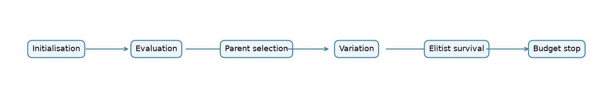
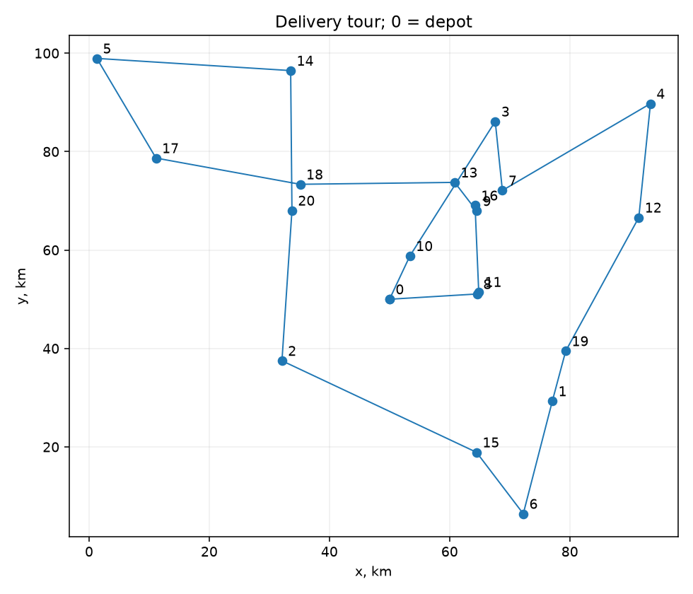
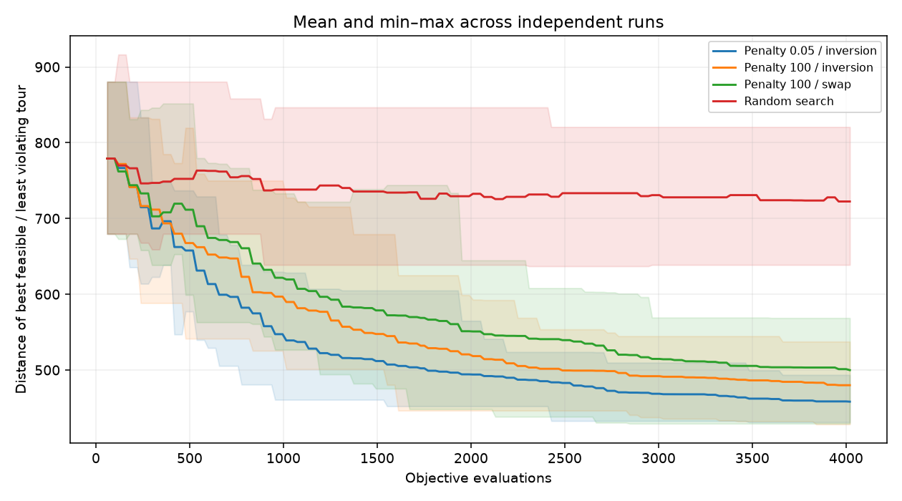

# Лабораторная работа 2 — маршрут доставки

## Предметная модель и ограничения

20 клиентов и депо 0. Замкнутый маршрут посещает каждого клиента ровно один раз и возвращается в депо.
Минимизируется сумма евклидовых расстояний. Ограничение: сумма времени на дугах и обслуживания ≤ T=1708.890 мин.
Все точки обязательны; удаление клиентов для выполнения лимита запрещено.
Генотип — перестановка 1…20; декодирование добавляет депо в начало и конец.
Координаты в квадрате 100×100 км, seed=10114; дуговые множители трафика U[0.7,2.8],
скорость 35 км/ч, обслуживание от 3 до 8 минут. Трафик асимметричен.
T равен 1.12 времени конструктивного маршрута ближайшего соседа по расстоянию.
Это гарантирует наличие допустимого решения, но не гарантирует допустимость оптимального по длине маршрута.
Полные матрицы сохранены в [data.json](data.json); внешние данные не используются.

## Операторы и сравнения

Популяция 60, турнир 3, OX с вероятностью 0.9, мутация с вероятностью 0.8, элита 1.
OX сохраняет сегмент первого родителя и относительный порядок остальных точек второго.
Инверсия сегмента и обмен двух точек сохраняют перестановку, поэтому структурный ремонт не нужен.
Временное ограничение учитывается штрафом: score=distance+λ·max(0,time−T).
Сравнение λ=0.05 и λ=100 при одной инверсии меняет только обработку ограничений;
сравнение инверсии и обмена при λ=100 меняет только оператор.
Random baseline использует тот же бюджет оценок случайных перестановок; из допустимых сохраняется кратчайшая.
Отдельный внешний регистратор лучшего решения у всех методов использует сначала допустимость,
затем минимальное нарушение или длину. Это не влияет на отбор родителей.
Два допустимых и два недопустимых примера с полными перестановками: [examples.json](examples.json).

## Экспериментальный протокол

Вариант 12: N=14, Q=1 (группа 517), Y=26; V=1+((17·14+7+26) mod 20)=12.
Seed данных: 10114. Seed запусков: 12000…12019.
В каждой конфигурации 20 независимых запусков, бюджет ровно 4020 вычислений.
Инициализация входит в бюджет. Повторная оценка элиты не производится.
Сравниваемые методы получают одинаковые seed, но различное потребление случайных чисел не означает попарного совпадения траекторий.
Время измерено perf_counter и зависит от машины; основной бюджет задан числом оценок.
Полные параметры: [results/config.json](results/config.json); каждый запуск: [results/runs.csv](results/runs.csv).
Траектории: [results/histories.json](results/histories.json), решения: [results/best.json](results/best.json).
Стандартное отклонение выборочное, ddof=1. Среднее не заменяет анализ допустимости.

## Результаты серии

| Метод | Лучшее | Среднее | Медиана | s | Худшее | Запусков |
|---|---:|---:|---:|---:|---:|---:|
| penalty_weak_inversion | 431.088 | 458.232 | 461.318 | 16.7305 | 493.474 | 20 |
| penalty_strong_inversion | 428.301 | 479.956 | 478.444 | 27.0063 | 537.496 | 20 |
| penalty_strong_swap | 429.258 | 499.863 | 495.783 | 36.3302 | 568.618 | 20 |
| random | 638.749 | 722.425 | 719.465 | 50.7074 | 820.745 | 20 |

| Метод | Доля допустимых итогов |
|---|---:|
| penalty_weak_inversion | 100% |
| penalty_strong_inversion | 100% |
| penalty_strong_swap | 100% |
| random | 5% |

## Предметный результат и вывод

Маршрут: 0 → 8 → 11 → 16 → 9 → 13 → 18 → 17 → 5 → 14 → 20 → 2 → 15 → 6 → 1 → 19 → 12 → 4 → 7 → 3 → 10 → 0.
Длина 428.301 км, время 1342.348 мин, превышение 0 мин.
Пошаговое время прибытия и обслуживание: [delivery.csv](results/delivery.csv).
Ближайший сосед: 419.933 км и 1525.795 мин.
Он является дополнительным ориентиром, его построение не входит в бюджеты сравниваемых поисков.
Средние длины в строке random включают недопустимые итоги: их нельзя считать качеством допустимых маршрутов.
Малый штраф дал медиану 461.318 км,
большой с инверсией — 478.444 км:
сильное давление на допустимость здесь ухудшило типичную длину, хотя оба ГА нашли допустимые решения во всех запусках.
Инверсия меняет порядок большого сегмента и при асимметричном трафике способна существенно изменить время;
обмен изменяет локальные связи. Их эффект виден в медианах и долях допустимости.
Штраф 0.05 допускает обмен больших временных нарушений на небольшое сокращение расстояния;
100 значительно сильнее направляет отбор в допустимую область.
Приемлемость результата определяется одновременно выполнением T и длиной относительно конструктивного ориентира.
Без точного решения нельзя утверждать глобальную оптимальность; ограничены модель трафика и один экземпляр данных.
