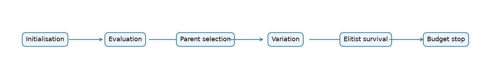
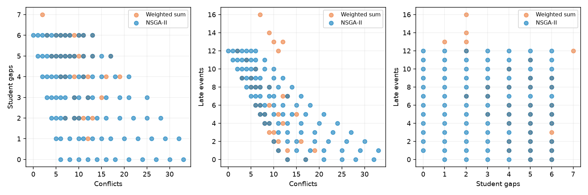

# Лабораторная работа 3 — многокритериальное расписание

## Трек A и формальная модель

24 занятия, 6 групп студентов, 5 преподавателей, 5 дней по 5 временных слотов.
Генотип — вектор 24 целочисленных слотов из доступных множеств внутри 0…24; фенотип — таблица «занятие — день — пара».
Пара конфликтует, если имеет общую группу или преподавателя; таких пар 87.
Генерация: группа i mod 6, преподаватель равномерно 0…4; seed=10114.
У каждой группы основной день (номер группы mod 5); каждому её занятию доступны
первая, третья и четвёртая пара этого дня и пятая пара следующего дня по циклу.
Это жёсткое ограничение доступности: инициализация и сброс гена выбирают только разрешённые слоты,
а кроссовер наследует допустимый слот того же занятия. Два ранних слота для четырёх занятий
создают конфликт между отсутствием пересечений и отказом от поздних пар.
Ограничений аудиторий в этой модели нет: число доступных аудиторий не ограничено.
Данные: [data.json](data.json). Все генотипы структурно допустимы; конфликтное расписание организационно недопустимо.

Три минимизируемые цели: f₁ — число конфликтующих пар в одном слоте;
f₂ — число незанятых слотов между первой и последней парой в каждом дне каждой группы;
f₃ — число занятий на четвёртой и пятой парах дня.
Пересечение занятий штрафуется f₁, а не исключается жёстким ремонтом: это позволяет изучать компромиссы.
Для практического выбора из фронта необходимо требовать f₁=0.

## Архитектура NSGA-II

Реализованы строгое доминирование, полная недоминируемая сортировка, crowding distance,
бинарный турнир по рангу и расстоянию, отбор из объединения родителей и потомков.
Популяция 60; равномерный кроссовер каждого гена; вероятность сброса гена в случайный слот 1/24.
Потомки всегда имеют корректный диапазон. Новые механизмы — Парето-сортировка и поддержание разнообразия.
Внешний архив хранит недоминируемые решения; для каждого одинакового вектора целей остаётся один генотип-свидетель.

Baseline — турнирный ГА со взвешенной суммой 0.5·f₁/C+0.3·f₂/96+0.2·f₃/24,
где C — число конфликтных пар. Нормировка фиксирована и не зависит от текущей популяции.
Архив одинаков у обоих методов; оценка не даёт NSGA-II преимущества за счёт хранения решений.
Сравнивается точный трёхмерный гиперобъём архивов относительно общей точки (C+1,97,25), больше — лучше.
Время вычисления сортировки и архивирования приведено в CSV, бюджет фитнес одинаков.

## Экспериментальный протокол

Вариант 12: N=14, Q=1 (группа 517), Y=26; V=1+((17·14+7+26) mod 20)=12.
Seed данных: 10114. Seed запусков: 12000…12019.
В каждой конфигурации 20 независимых запусков, бюджет ровно 12060 вычислений.
Инициализация входит в бюджет. Повторная оценка элиты не производится.
Сравниваемые методы получают одинаковые seed, но различное потребление случайных чисел не означает попарного совпадения траекторий.
Время измерено perf_counter и зависит от машины; основной бюджет задан числом оценок.
Полные параметры: [results/config.json](results/config.json); каждый запуск: [results/runs.csv](results/runs.csv).
Траектории: [results/histories.json](results/histories.json), решения: [results/best.json](results/best.json).
Стандартное отклонение выборочное, ddof=1. Среднее не заменяет анализ допустимости.

## Результаты серии

| Метод | Лучшее | Среднее | Медиана | s | Худшее | Запусков |
|---|---:|---:|---:|---:|---:|---:|
| nsga2 | 0.0903017 | 0.0940517 | 0.094181 | 0.00196333 | 0.0980603 | 20 |
| weighted | 0.0903017 | 0.0903017 | 0.0903017 | 1.42383e-17 | 0.0903017 | 20 |

| Метод | Средний HV | s(HV) | Среднее число разных векторов целей | Доля запусков с f₁=0 |
|---|---:|---:|---:|---:|
| nsga2 | 203792.050 | 754.919 | 88.75 | 45% |
| weighted | 196047.950 | 1116.058 | 35.35 | 0% |

В общей таблице value — минимальная взвешенная сумма в архиве. Она вспомогательная;
основная метрика покрытия компромиссов — HV. Гиперобъём зависит от выбранной общей опорной точки.

## Характерные решения

Векторы (конфликты, окна, поздние занятия): [0.0, 6.0, 12.0], [13.0, 6.0, 0.0], [33.0, 0.0, 1.0].
Первое минимизирует конфликты (при равенстве — поздние занятия), второе — поздние занятия;
третье выбирается для покрытия удалённой части фронта.
Меньшее первое число означает более пригодное расписание, второе — удобство студентов, третье — отказ от поздних пар.
Это компромиссы выбранного запуска, а не доказанный точный фронт всей задачи.
Полные три вектора назначений: [representatives.json](results/representatives.json);
таблица первого расписания: [timetable.csv](results/timetable.csv).

## Вывод и ограничения

Взвешенная сумма задаёт одно предпочтение; NSGA-II поддерживает несколько направлений улучшения одновременно.
Разница средних HV и числа уникальных векторов показывает влияние поддержания разнообразия.
Средний HV NSGA-II: 203792.050; взвешенная сумма: 196047.950.
Доля запусков с бесконфликтным решением: 45% и 0% соответственно.
Положительное f₁ означает, что решение нельзя применять без исправления конфликтов,
даже если его окна и поздние занятия лучше. Качество нужно оценивать по всем трём координатам.
Модель не включает вместимость аудиторий, индивидуальные предпочтения и переносы между корпусами.
Увеличение бюджета и включение специализированной мутации конфликтных занятий могут улучшить применимость.
