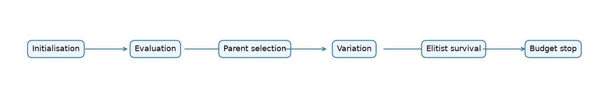
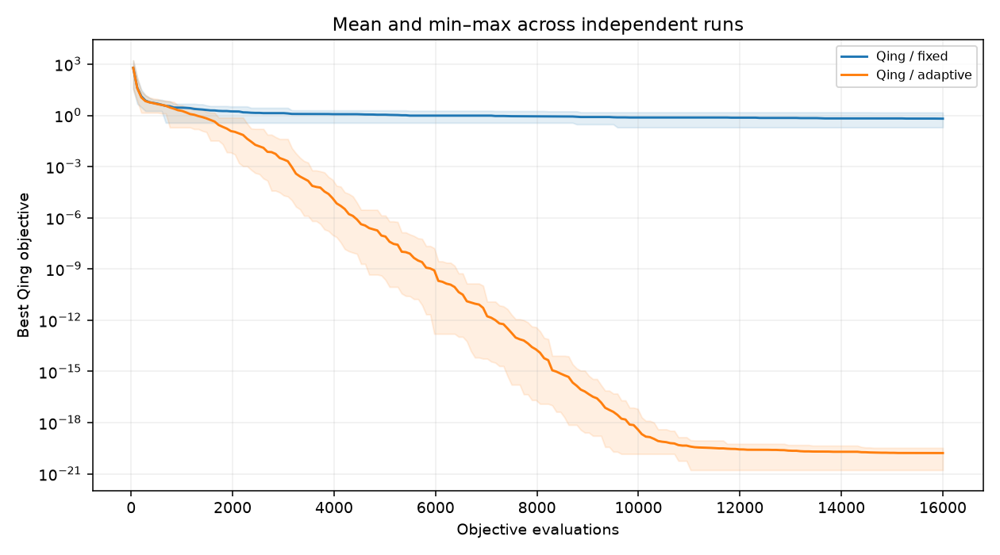
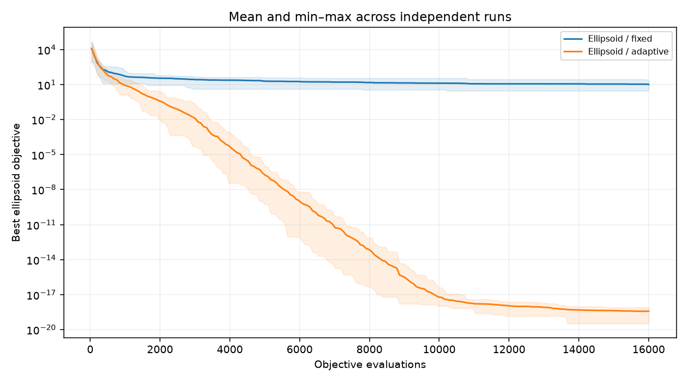
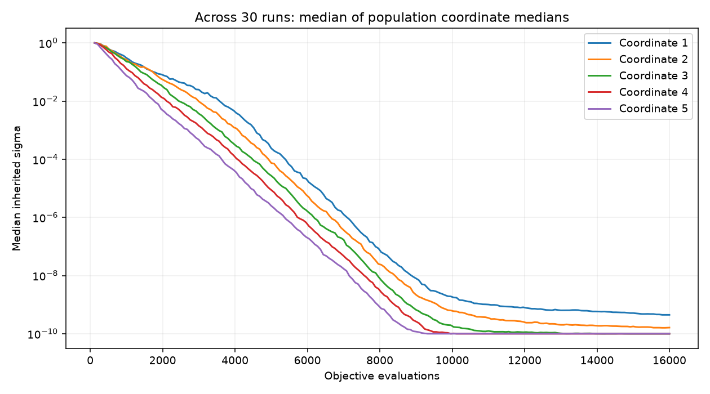

# Лабораторная работа 4 — самоадаптирующаяся стратегия эволюции

## Исследовательский вопрос

Улучшает ли наследуемый покоординатный шаг мутации точность (μ+λ)-ES при одном бюджете
относительно фиксированного шага на мультимодальной и анизотропной функции?
Заявка и риски: [PROPOSAL.md](PROPOSAL.md). Заявка документирует тему; факт утверждения преподавателем не заявляется.

## Модель и архитектура

Две функции размерности 5 на [-10,10]⁵: Цин Σ(xᵢ²−i)² и эллипсоид Σ10^(4(i−1)/4)xᵢ².
У обеих минимум 0; у эллипсоида x=0, у Цин xᵢ=±√i.
Диапазон Цин здесь уменьшен относительно ЛР1 специально для исследования донастройки;
сравнивать абсолютные результаты ЛР1 и ЛР4 как одинаковые условия нельзя.
Число обусловленности эллипсоида 10⁴; разные координаты требуют разных шагов.
Данные аналитические, внешних источников и симуляционных случайностей нет.

Генотип адаптивной ES: (x₁…x₅,σ₁…σ₅), фенотип x. Начальные σ=1 для обеих версий.
μ=40, λ=80; родители равновероятно выбираются с возвращением.
Рекомбинация x — арифметическое среднее, σ — геометрическое.
Адаптация: σᵢ′=σᵢ·exp(τ₀Z₀+τZᵢ), где τ₀=1/√(2d), τ=1/√(2√d),
Z₀ общий для особи, Zᵢ независимы. σ ограничен [10⁻¹⁰,20].
Затем xᵢ′=xᵢ+σᵢ′Nᵢ, границы отражаются; выбираются μ лучших из родителей и потомков.
В фиксированной версии наследуемые σ остаются равными 1. Это единственная разница алгоритмов.
Отбор плюс сохраняет найденный минимум; последнее поколение обрезается до бюджета.
Система состоит из генератора кандидатов, наследования стратегии, счётчика оценок,
элитистского отбора, журнала координатных шагов и экспериментального анализатора.

## Экспериментальный протокол

Вариант 12: N=14, Q=1 (группа 517), Y=26; V=1+((17·14+7+26) mod 20)=12.
Seed данных: 10114. Seed запусков: 12000…12029.
В каждой конфигурации 30 независимых запусков, бюджет ровно 16000 вычислений.
Инициализация входит в бюджет. Повторная оценка элиты не производится.
Сравниваемые методы получают одинаковые seed, но различное потребление случайных чисел не означает попарного совпадения траекторий.
Время измерено perf_counter и зависит от машины; основной бюджет задан числом оценок.
Полные параметры: [results/config.json](results/config.json); каждый запуск: [results/runs.csv](results/runs.csv).
Траектории: [results/histories.json](results/histories.json), решения: [results/best.json](results/best.json).
Стандартное отклонение выборочное, ddof=1. Среднее не заменяет анализ допустимости.

## Результаты серии

| Метод | Лучшее | Среднее | Медиана | s | Худшее | Запусков |
|---|---:|---:|---:|---:|---:|---:|
| qing_fixed | 0.19786 | 0.640246 | 0.580463 | 0.326115 | 1.47823 | 30 |
| qing_adaptive | 1.667e-21 | 1.65623e-20 | 1.61601e-20 | 6.61625e-21 | 3.32948e-20 | 30 |
| ellipsoid_fixed | 2.98309 | 10.3448 | 10.5672 | 4.90479 | 22.1743 | 30 |
| ellipsoid_adaptive | 3.35135e-20 | 3.81988e-19 | 4.11174e-19 | 1.90533e-19 | 7.98345e-19 | 30 |

## Устойчивость и эффект адаптации

На qing: адаптивная версия лучше в 30 из 30 пар, фиксированная в 0, совпадений 0; отношение медиан fixed/adaptive = 3.592e+19.
На ellipsoid: адаптивная версия лучше в 30 из 30 пар, фиксированная в 0, совпадений 0; отношение медиан fixed/adaptive = 2.57e+19.

Сравнение попарно по seed является описательным; статистическая значимость без отдельного теста не утверждается.
Графики показывают среднее и полный min–max диапазон всех 30 запусков, а не одну удачную траекторию.
На эллипсоиде различие наследуемых σ по координатам показывает механизм приспособления к анизотропии.
Пригодность оценивается близостью к известному нулю, медианой и худшим запуском при равной стоимости фитнеса.

## Ограничения и развитие

Покоординатная адаптация не обучает поворот системы координат; повёрнутый эллипсоид потребовал бы ковариационной адаптации.
Исследованы две функции, одна размерность и один начальный масштаб. Эти результаты не доказывают универсальное превосходство.
На мультимодальной Цин возможна преждевременная сходимость к одному бассейну, хотя его глобальный минимум равноценен остальным.
Следующие эксперименты: вращение эллипсоида, размерности 10/20, рестарты и ковариационная стратегия.
План демонстрации на 5–7 минут: [DEMO.md](DEMO.md).
